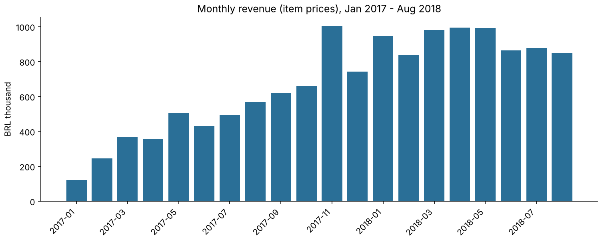
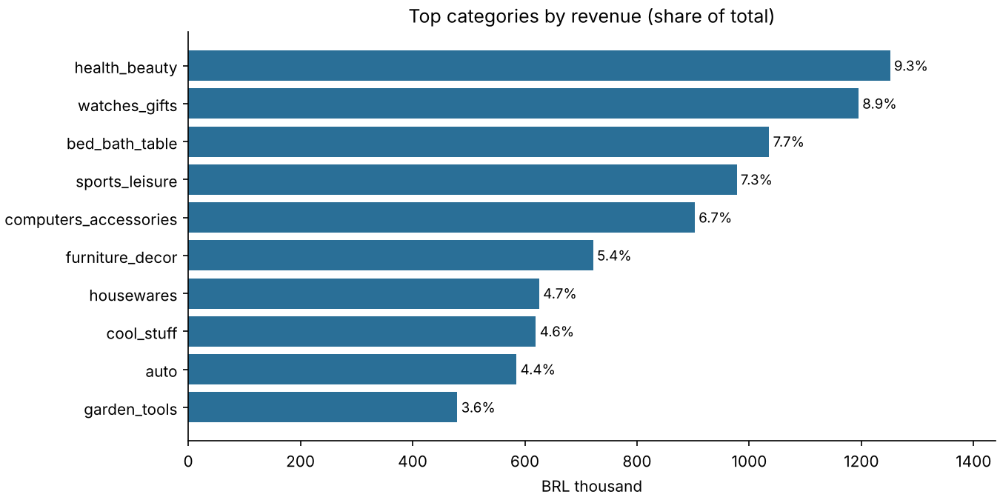
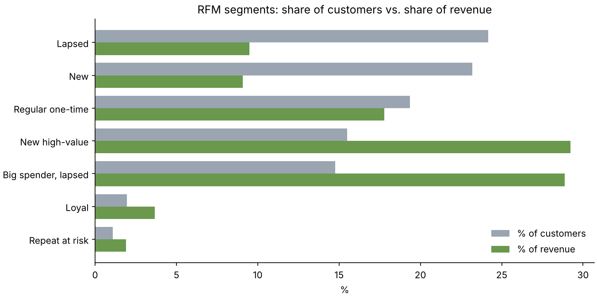

# Olist E-commerce: Sales, Delivery and RFM Customer Analysis

Python analysis of the public **Olist Brazilian e-commerce dataset** (about 100k orders, 2016-2018). It answers four business questions:

1. How did sales develop over time?
2. Which product categories drive revenue?
3. How reliable is delivery, and does lateness hurt customer satisfaction?
4. Which customer groups matter most (RFM segmentation)?

> Portfolio project for learning and demonstration. Findings describe this historical dataset only.

## Key findings
| Question | Result |
|---|---|
| Sales | **13.4 M BRL** item revenue over 20 full months (Jan 2017 - Aug 2018); monthly revenue grew from about 120k BRL (Jan 2017) to roughly 840k-990k BRL per month in 2018. November 2017 is the first month above 1 M BRL (coincides with the Black Friday period). Average order value stays between about 130 and 150 BRL. |
| Categories | Top 5 categories make up **39.9%** of revenue, top 10 make up **62.4%**. Largest: health_beauty (9.3%), watches_gifts (8.9%), bed_bath_table (7.7%). |
| Delivery | Median delivery time **10.2 days**; **8.1%** of delivered orders arrive after the estimated date. Late rates are highest in the north-east (MA 19.6%, CE 15.4%, BA 14.1%), where median delivery takes 17-19 days. |
| Satisfaction | Average review score is **4.30 for on-time orders vs. 2.57 for late orders**. |
| Customers | Only about **3% of customers order more than once**. The "New high-value" and "Big spender, lapsed" segments are ~30% of customers but **~58% of revenue**. |

### RFM segments
| Segment | Customers | % customers | % revenue |
|---|---|---|---|
| New high-value | 14,717 | 15.5 | 29.2 |
| Big spender, lapsed | 14,010 | 14.8 | 28.9 |
| Regular one-time | 18,375 | 19.3 | 17.8 |
| Lapsed | 22,954 | 24.2 | 9.5 |
| New | 22,040 | 23.2 | 9.1 |
| Loyal | 1,858 | 2.0 | 3.7 |
| Repeat at risk | 1,029 | 1.1 | 1.9 |





**Possible actions:** win-back campaigns for the "Big spender, lapsed" group (about 29% of revenue, no purchase for ~400 days on average); a second-purchase incentive for "New high-value" customers; and delivery improvements in the north-east, since late orders score about 1.7 points lower.

## Method and decisions
- **Customer = `customer_unique_id`.** In Olist `customer_id` is created per order, so using it would make every customer look like a one-time buyer.
- **Excluded:** orders that are `canceled` or `unavailable`, and orders without items. 98,199 valid orders and 94,983 customers remain.
- **Revenue** = sum of item prices (freight reported separately). Payment totals differ from items + freight in about 250 orders, so payments are not used for revenue.
- **Period:** only full months (Jan 2017 - Aug 2018); 2016 and Sep-Oct 2018 are too sparse.
- **RFM:** Recency and Monetary use quintile scores (rank-based, so ties do not break the bins). Because ~97% of customers have a single order, Frequency is scored by rule (1, 2, 3+) and segments are rule-based. The segment thresholds are my own choices and can be tuned in `rfm.py`.
- **Late** = delivered after the estimated delivery date.

## Run it
The raw data is **not** included in this repository (size and license). Download it from Kaggle: search for *"Brazilian E-Commerce Public Dataset by Olist"*, unzip it and put the CSV files into `data/raw/`.

```bash
pip install -r requirements.txt
python -m olist_analysis --raw data/raw --out outputs   # about 5 seconds
python -m pytest -q                                      # 14 tests
```
Outputs (aggregated tables and charts only, no customer-level data) are written to `outputs/`.

## Layout
```
olist_analysis/load.py      read CSVs
olist_analysis/clean.py     order and item tables, cleaning decisions
olist_analysis/metrics.py   sales, categories, delivery, reviews
olist_analysis/rfm.py       RFM scoring and segments
olist_analysis/report.py    CSV and charts
tests/test_core.py          cleaning rules, scoring and segment rules on small fixtures
```

## Limitations
- Descriptive analysis; the link between late delivery and low reviews is an association, not proof of cause.
- Customers are observed over a short window, so "lapsed" mostly means "has not bought again yet".
- Dataset: Olist, published on Kaggle under CC BY-NC-SA 4.0 (check the Kaggle page for current terms). Data is anonymised.

---
**Türkçe özet:** Olist açık e-ticaret veri seti üzerinde satış trendi, kategori geliri, teslimat gecikmesi ve RFM müşteri segmentasyonu analizi. Ana bulgular: 20 ayda 13,4 milyon BRL ciro; müşterilerin yalnızca yaklaşık %3'ü tekrar alışveriş yapıyor; geç teslim edilen siparişlerin ortalama puanı 2,57, zamanında gelenlerin 4,30. Ham veri depoda yok, Kaggle'dan indirilip `data/raw/` klasörüne konmalı. Bu proje öğrenme ve gösterim amaçlıdır.
